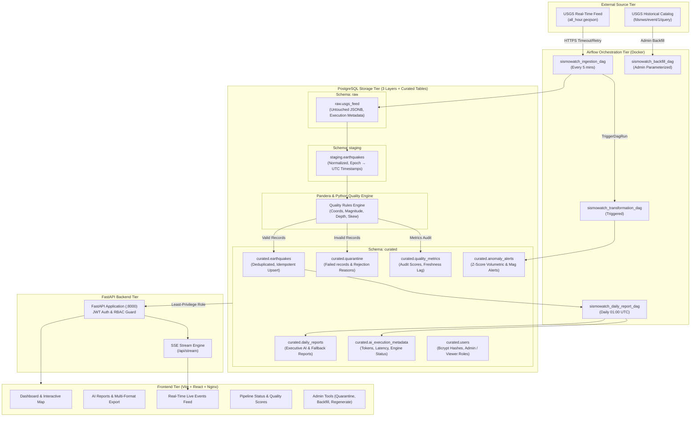
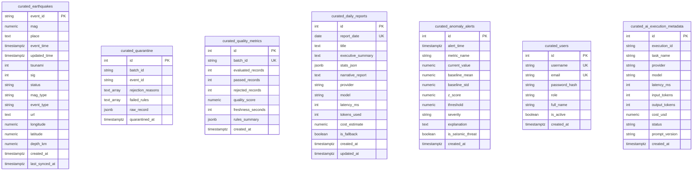

# SismoWatch Architecture & System Design Document

> [!NOTE]
> SismoWatch is a production-grade, containerized seismic monitoring and data platform designed for SuperApp's Risk Operations and Emergency Management teams. It ingests public USGS earthquake feeds, validates data quality through multi-layer quarantine controls, detects statistical anomalies deterministically, automates executive AI reporting with strict anti-hallucination guardrails, and serves insights via an RBAC-secured real-time web application.

---

## 1. Executive Summary & Business Problem

SuperApp operates global logistics, insurance, and ride-hailing services. Regional operational hubs and risk managers require immediate, reliable situational awareness whenever seismic activity occurs:
- **Where** did the tremor happen, and how deep was the hypocenter?
- **What** was the verified magnitude, and did it trigger tsunami warnings?
- **Is** the event an unusual cluster or statistical surge compared to historical baselines?
- **Can** emergency teams trust the data, knowing bad or corrupted sensor records are strictly quarantined without polluting analytical reporting?

Before SismoWatch, the team depended on raw public feeds that refreshed every minute without historical storage, schema validation, executive summarization, or access controls. SismoWatch converts this ephemeral stream into a reliable, defensible, and audited data asset.

---

## 2. End-to-End Component & Data-Flow Architecture



---

## 3. Storage Layering: Raw, Staging, and Curated

| Layer | PostgreSQL Schema | Storage Characteristics | Access Privileges | Purpose |
|---|---|---|---|---|
| **Raw** | `raw` | Append-only, untouched JSONB payloads, HTTP status, batch ID, ingestion execution metadata. | `sismowatch_admin`, Airflow | Complete auditability and replayability. If downstream schemas or logic change, raw data can be reprocessed without external API dependence. |
| **Staging** | `staging` | Ephemeral/transitional structured records. Epoch milliseconds converted to ISO UTC timestamps. | `sismowatch_admin`, Airflow | Prepares uniform data types and coordinate fields before quality rule evaluation. |
| **Curated** | `curated` | Enforced primary key (`event_id`), verified constraints, deduplicated via idempotent upserts. | `sismowatch_app` (SELECT, limited INSERT for admin), `sismowatch_admin` | Query-ready analytical warehouse serving dashboards, KPIs, time series, anomaly alerts, and AI reports. |

---

## 4. Database Schema and Entity Relationships



---

## 5. Why Apache Airflow (vs. Cron or Simple Scripts)?

A simple cron job or detached daemon is insufficient for production data engineering:
1. **DAG Dependency & Backpressure Management**: SismoWatch separates ingestion from transformation. Transformation is triggered only when ingestion succeeds. Ingestion does not block if downstream curation needs retry.
2. **State & Lineage Tracking**: Airflow provides persistent run state, execution logical timestamps (`logical_date`), task duration metrics, and XCom parameter handoff between tasks.
3. **Resilient Retry & Timeout Policies**: Network requests to USGS are protected by exponential backoff (`retries=3`, `retry_delay=30s`, `execution_timeout=4m`). If the external API experiences downtime, Airflow queues retries without losing data.
4. **Idempotent Parameterized Backfill**: Historical backfill for 30 days is natively modeled as a parameterized DAG with defined parameters (`starttime`, `endtime`, `minmagnitude`), allowing manual or automated triggering without ad-hoc shell scripts.
5. **Operational UI & Observability**: Team members can inspect DAG logs, rerun specific task instances, and view execution graphs without terminal access to the host server.

---

## 6. Data Quality Rules & Quarantine Controls

Invalid data must never corrupt analytical dashboards. However, **quality control must not prevent valid records from reaching curated**.

### Validation Matrix

| Rule ID | Field | Condition / Threshold | Rejection Classification |
|---|---|---|---|
| `REQUIRED_EVENT_ID` | `event_id` | Must be non-empty string | Invalid Schema / Missing Identifier |
| `INVALID_TIMESTAMP` | `time` | Epoch ms > 0, parseable into UTC datetime | Clock / Parsing Failure |
| `TIMESTAMP_FUTURE_SKEW` | `time` | Max 1 hour in the future (`<= now + 3600s`) | Clock Skew |
| `LATITUDE_OUT_OF_BOUNDS` | `latitude` | `[-90.0, 90.0]` | Geographic Coordinate Violation |
| `LONGITUDE_OUT_OF_BOUNDS` | `longitude` | `[-180.0, 180.0]` | Geographic Coordinate Violation |
| `DEPTH_OUT_OF_BOUNDS` | `depth_km` | `[-5.0, 800.0]` km | Physical Subduction Depth Limit |
| `MAGNITUDE_OUT_OF_BOUNDS`| `mag` | `[-2.0, 10.0]` | Physical Tectonic Energy Limit |
| `MISSING_PLACE` | `place` | Non-empty string | Location Context Missing |

> [!IMPORTANT]
> **Separation of Quality from Unusual Seismic Activity**:
> Micro-earthquakes legitimately possess negative magnitudes (e.g., $M -0.5$). Severe earthquakes ($M 8.5$ or $M 9.0$) are extremely rare but physically valid. SismoWatch does not reject earthquakes with high magnitudes; they are flagged as **significant** and evaluated by anomaly detection, rather than quarantined. Only values outside physical bounds ($M > 10.0$ or $M < -2.0$) or non-numeric values are quarantined.

### Quarantine Mechanism
When a feature fails any rule:
1. It is appended to `quarantined_records` with an array of `rejection_reasons` and `failed_rules`.
2. It is inserted into `curated.quarantine`.
3. It is excluded from the list passed to `upsert_curated_records`.
4. The batch quality score is updated: $\text{Quality Score} = \left(\frac{\text{Passed}}{\text{Evaluated}}\right) \times 100$.

---

## 7. Security Boundaries & Role-Based Access Control (RBAC)

### Security Dimensions

```
   [ Public Client ]
           │
           │ HTTPS / JWT
           ▼
┌──────────────────────────────────────┐
│          FastAPI Gateway             │
│  - JWT Bearer & Query Token Support  │
│  - CORS Allowed Origins Restriction  │
│  - Safe Parameterized SQL Only       │
└──────────────────┬───────────────────┘
                   │
         Role-Based Access
         ┌─────────┴─────────┐
         ▼                   ▼
     [ Viewer ]           [ Admin ]
     - Dashboard          - Everything Viewer can
     - KPIs & Timeseries  - GET /api/quality/quarantine
     - Daily AI Reports   - POST /api/admin/backfill
     - SSE Live Stream    - POST /api/admin/reports/regenerate
     - Pipeline Status    - Raw payload inspection
```

### Least Privilege Database Role
- `sismowatch_app`:
  - Granted `USAGE` on schema `curated` only.
  - Granted `SELECT` on curated analytical tables.
  - Revoked all privileges on `raw` and `staging` schemas.
- `sismowatch_admin`:
  - Dedicated administrative role used by Airflow and database initialization scripts.

### Backend Enforcement
Authorization is strictly enforced in FastAPI route dependencies (`require_admin`, `require_viewer_or_admin`). Even if a viewer crafts direct HTTP requests with tools like `curl` or Postman, the backend rejects the request with HTTP `403 Forbidden`.

---

## 8. AI Narrative Reports & Anomaly Detection

### A. Anti-Hallucination & Grounding Guarantee
Large Language Models must **never invent** seismic numbers, epicenters, or casualties:
1. **Prior Calculation**: All statistics (event count, max magnitude, mean magnitude, tsunami flag count, significant events, and top active regions) are calculated deterministically in PostgreSQL and Python **before** composing the prompt.
2. **Strict Grounding Prompt**: The prompt explicitly instructs the model to rely solely on the provided figures and forbids any extrapolation.
3. **Structured Pydantic Validation**: Output is validated against `DailyReportSchema(title, executive_summary, narrative_report)`.
4. **Deterministic Fallback**: If the external LLM provider fails, times out, or returns non-conforming JSON, the system immediately invokes `generate_deterministic_report()`. The pipeline never breaks, and the report is labeled with `is_fallback = TRUE`.

### B. Statistical Anomaly Detection (Deterministic)
The system calculates rolling hourly activity statistics over a 48–72 hour baseline:
$$\mu = \frac{1}{N}\sum_{i=1}^N x_i, \quad \sigma = \sqrt{\frac{1}{N-1}\sum_{i=1}^N (x_i - \mu)^2}$$
$$Z = \frac{x_{\text{current}} - \mu}{\sigma}$$
- If $|Z| \ge 2.5$, an alert is recorded into `curated.anomaly_alerts`.
- **Disclaimer**: Alerts are explicitly labeled with `is_seismic_threat = FALSE`. The system strictly informs users of statistical distribution deviations without claiming to predict earthquake occurrences.

---

## 9. Real-Time Communication Architecture: Server-Sent Events (SSE)

SismoWatch utilizes **Server-Sent Events (SSE)** via HTTP (`/api/stream`) for real-time live events:
- **Why SSE over WebSocket?**:
  - Seismic monitoring is primarily **unidirectional** (server to client).
  - SSE runs over standard HTTP/1.1 or HTTP/2, natively avoiding firewall and proxy blockages.
  - Native browser `EventSource` provides automatic reconnection and backoff out of the box.
  - Built-in event types (`earthquake_update`, `connect`, `: heartbeat`) simplify client dispatching.
- **Resilience**: A background heartbeat comment (`: heartbeat <timestamp>\n\n`) is emitted every 5 seconds to prevent reverse proxy (Nginx) connection drops.

---

## 10. Technical Trade-Offs & Production Improvements

| Area | Current Implementation | Production Evolution |
|---|---|---|
| **Airflow Architecture** | LocalExecutor with single container scheduler and webserver. | CeleryExecutor or KubernetesExecutor with Celery workers for horizontal scaling. |
| **Database** | PostgreSQL on single Docker volume. | Managed PostgreSQL (AWS RDS / Cloud SQL / Supabase) with read-replicas for analytical queries. |
| **Geospatial Queries** | Standard numeric coordinates with composite indexes. | PostGIS extension with geometry data types (`ST_Point`, `ST_DWithin`) for polygon containment queries. |
| **Secrets Management** | Environment variables populated via Docker Compose. | Cloud Secrets Manager (AWS Secrets Manager / HashiCorp Vault) with automated credential rotation. |
| **Real-Time Streaming**| SSE polling curated database sync timestamps. | Redis Pub/Sub or PostgreSQL `LISTEN/NOTIFY` channels to publish new events instantly to the SSE worker. |
